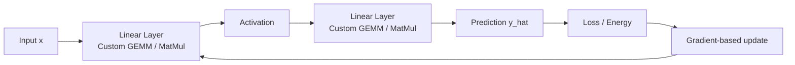

# Mini_Ctorch

> A compact deep learning stack built from scratch in **C** and **CUDA**, focused on
> **custom tensor operations**, **GPU kernels**, **matrix multiplication**,
> **network construction**, and **end-to-end training**.

<p align="center">
  
</p>

<p align="center">
  <b>Low-level ML systems work</b> · <b>CUDA kernels</b> · <b>Neural network training</b>
</p>

---

## What this project is about

Mini_Ctorch is not just a toy training demo. It is a **from-scratch implementation of core neural-network machinery** with an emphasis on the engineering pieces that high-level frameworks usually hide.

It is designed to show hands-on work in

- **CUDA programming** for custom GPU computation
- **matrix multiplication kernels**, the computational backbone of neural networks
- **manual network construction** from low-level building blocks
- **forward computation, loss evaluation, and training**
- **ML systems understanding** beyond high-level framework use

---

## Core idea

The demo visualizes a small neural network learning a target function by repeatedly applying

1. a **forward pass** through custom layers
2. a **loss / energy computation**
3. a **parameter update step**
4. continued iteration until the network approximates the target behavior



---

## Why the CUDA side matters

At the center of this project is the low-level implementation of GPU-side computation.
Neural-network execution is fundamentally built on repeated dense linear algebra, especially matrix multiplication.
Mini_Ctorch therefore highlights the part that matters most for scalable learning systems.

### Matrix multiplication

For layer computation,

$$
\mathbf{C} = \mathbf{A}\mathbf{B}
$$

and for a linear layer,

$$
\mathbf{y} = \mathbf{W}\mathbf{x} + \mathbf{b}
$$

These operations are where custom CUDA kernels become important. They define how efficiently data is moved, multiplied, accumulated, and written back on the GPU.

### What this demonstrates

| Area | What Mini_Ctorch shows |
|---|---|
| GPU programming | Writing and using custom CUDA code rather than only calling high-level libraries |
| Core ML compute | Matrix multiplication and tensor-style numerical operations |
| Model building | Constructing a neural network from lower-level components |
| Training | Running optimization on a target task rather than only doing inference |
| Systems understanding | Connecting math, memory, kernels, and learning behavior |

---

## Example network used in the demo

The training animation can be contextualized as a small feed-forward regression network.
Even though the exact demo configuration should be filled in from the source, the structure is conceptually of the form

$$
\mathbf{x}
\;\rightarrow\;
\mathrm{Linear}(d_{in}, h_1)
\;\rightarrow\;
\phi
\;\rightarrow\;
\mathrm{Linear}(h_1, h_2)
\;\rightarrow\;
\phi
\;\rightarrow\;
\mathrm{Linear}(h_2, d_{out})
\;\rightarrow\;
\hat{y}
$$

where

- $d_{in}$ is the input dimension
- $h_1, h_2$ are hidden-layer widths
- $d_{out}$ is the output dimension
- $\phi$ is the chosen nonlinearity

A visual view of the same idea

```text
Input x
   │
   ▼
[ Linear ]  W1 x + b1
   │
   ▼
[ Activation ]
   │
   ▼
[ Linear ]  W2 h + b2
   │
   ▼
[ Activation ]
   │
   ▼
[ Linear ]  W3 h + b3
   │
   ▼
Prediction y_hat
```

### Fill in the exact demo architecture

Replace the generic form above with your exact setup, for example

- input dimension
- number of hidden layers
- hidden widths
- activation functions
- output dimension

That will make the README technically precise while keeping the visual presentation.

---

## Ground-truth function

The network in the demo is trained to approximate a target or ground-truth function

$$
y = f_{\mathrm{GT}}(x)
$$

For the README, it is useful to show the exact analytic form used by the demo. Insert it directly here once confirmed from the implementation.

### Template

$$
f_{\mathrm{GT}}(x) = \text{[insert the exact target function used in the demo]}
$$

Examples of what this section is meant to communicate

- whether the task is **curve fitting / regression**
- whether the target is **smooth, nonlinear, oscillatory, piecewise, or polynomial**
- what behavior the network is expected to learn

This makes the animation immediately interpretable to the reader.

---

## Loss / energy function

The training objective should also be made explicit in mathematical form.
For a standard regression demo, this is often the mean squared error

$$
\mathcal{L}(\theta)
= \frac{1}{N}\sum_{i=1}^{N}
\left\lVert f_{\theta}(x_i) - f_{\mathrm{GT}}(x_i) \right\rVert_2^2
$$

where

- $f_{\theta}$ is the neural network with parameters $\theta$
- $f_{\mathrm{GT}}$ is the target function
- $N$ is the number of training samples

If your implementation uses a different energy or objective, replace the formula with the exact one from the code.

This section matters because it closes the loop between

- the **architecture**,
- the **target function**,
- and the **training animation**.

---

## Interpreting the demo GIF

The training visualization is intended to show the model gradually learning the target behavior.
Depending on how your script renders it, the animation can communicate one or more of the following

- the predicted curve approaching the ground-truth curve
- the effect of iterative parameter updates
- the progression of optimization over training iterations
- the emergence of a usable approximation from low-level compute primitives

In other words, the GIF is not just a visual. It is the visible outcome of

- custom mathematical operations,
- network execution,
- and GPU-accelerated training.

---

## Implementation focus

Mini_Ctorch is especially relevant as a portfolio project because it shows work below the abstraction level of mainstream ML frameworks.

### Technical emphasis

- **C implementation** of core deep-learning components
- **CUDA kernel programming** for performance-critical operations
- **matrix multiplication** as a central primitive
- **manual neural-network assembly**
- **training logic** rather than only static computation
- **understanding of the computational path from math to GPU execution**

---

## Suggested next improvements

To make this repository even stronger, the next valuable additions would be

1. a short code example of the CUDA matrix multiplication kernel
2. a concrete example of the layer or tensor API
3. the exact architecture values used in the demo
4. the exact ground-truth function
5. the exact loss / energy function
6. build and run instructions
7. optional runtime or CPU-versus-GPU comparison numbers

---

## Summary

Mini_Ctorch is a compact but meaningful demonstration of **deep-learning systems implementation**.
It highlights the engineering foundations of neural networks, especially

$$
\text{math} \;\rightarrow\; \text{kernels} \;\rightarrow\; \text{network execution} \;\rightarrow\; \text{training behavior}
$$

That makes it a strong project for showing practical capability in

- CUDA programming
- matrix-oriented computation
- neural-network fundamentals
- low-level ML engineering

